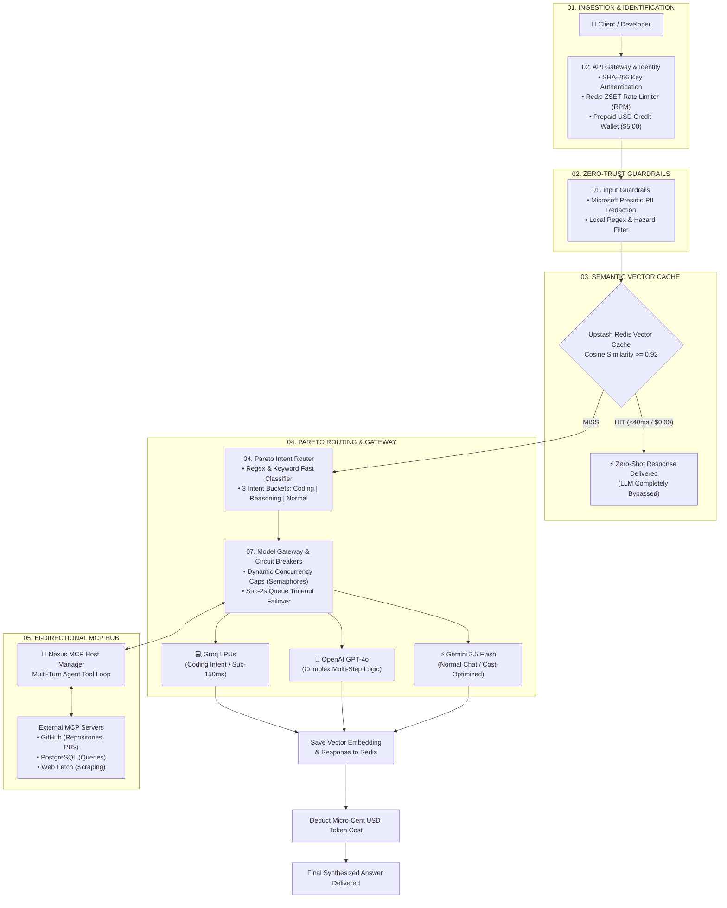

<div align="center">

# ⚡ NEXUS AI GATEWAY & INFERENCE PLATFORM
### Enterprise Multi-Tier AI Orchestrator, Semantic Caching Engine & Bi-Directional Model Context Protocol (MCP) Hub

[](https://fastapi.tiangolo.com)
[](https://www.python.org/)
[](https://react.dev/)
[](https://tailwindcss.com/)
[](https://upstash.com/)
[](https://modelcontextprotocol.io/)
[](LICENSE)

<p align="center">
  <b>A production-grade, distributed AI Gateway designed to slash inference costs by up to 92%, enforce zero-trust PII sanitization, and bridge native developer environments (Claude Desktop, Cursor) with external enterprise tools via a Bi-Directional MCP Hub.</b>
</p>

[Key Features](#-core-capabilities) •
[Architecture](#-master-system-architecture) •
[MCP Hub](#-bi-directional-model-context-protocol-mcp-hub) •
[Benchmarks & SLAs](#-model-benchmarks--pareto-routing-slas) •
[Quickstart](#-quickstart-guide) •
[API Reference](#-rest-api-catalog)

</div>

---

## 🌟 Core Capabilities

| Capability | Technical Implementation | Business & Production Impact |
| :--- | :--- | :--- |
| **⚡ Pareto 3-Tier Dynamic Routing** | Real-time query classification into `Coding`, `Reasoning`, and `Normal` intents. | Routes code to **Groq**, logic to **OpenAI**, and chat to **Gemini 2.5 Flash**, saving ~92% cost vs brute-force GPT-4o. |
| **🔒 Zero-Trust Presidio PII Masking** | In-flight regex & NLP redaction of emails, international phone numbers, SSNs, credit cards, and bank credentials. | Prevents sensitive organizational PII from leaking to upstream LLM providers. |
| **💾 Redis Semantic Cosine Cache** | Upstash Redis vector similarity search with cosine distance threshold $\ge 0.92$. | Instant **sub-40ms zero-shot returns** at **$0.00 cost** on repeated or semantically similar queries. |
| **🔌 Bi-Directional MCP Hub** | Native JSON-RPC 2.0 `stdio` server + dual-mode (`stdio`/`SSE`) MCP Host Manager. | **Inbound**: Claude Desktop & Cursor query Nexus. <br>**Outbound**: Nexus models autonomously execute GitHub, Postgres & Web tools. |
| **🛡️ Stateful Circuit Breakers** | In-memory 3-state finite state machines (`CLOSED`, `OPEN`, `HALF-OPEN`) with 2s concurrency queue caps. | Auto-fails over downstream requests in <1ms during upstream LLM outages or rate limits (429s). |
| **👥 Human-in-the-Loop (HITL) Queue** | Intercepts high-risk destructive mutations (DB drops, wire transfers, refund triggers). | Blocks unauthorized autonomous execution and creates verifiable human supervisor approval tickets. |
| **📊 Real-Time Rolling Observability** | Rolling 1-hour Redis Sorted-Set (ZSET) sliding-window telemetry. | Streams P50/P95/P99 latency percentiles, token usage accounting, and cumulative USD cost avoidance. |

---

## 🏛️ Master System Architecture



---

## 🔌 Bi-Directional Model Context Protocol (MCP) Hub

Nexus implements the official **Anthropic Model Context Protocol (MCP) Specification (`2024-11-05`)** on both sides of the wire:

```
┌─────────────────────────────────────────────────────────────────────────────────────────┐
│                               NEXUS BI-DIRECTIONAL MCP HUB                              │
│                                                                                         │
│   [ 1. INBOUND: NEXUS AS AN MCP SERVER ]       [ 2. OUTBOUND: NEXUS AS AN MCP HOST ]    │
│                                                                                         │
│   Claude Desktop / Cursor IDE                  Nexus Interactive Playground             │
│            │ (stdio JSON-RPC)                               │ (Multi-Turn Agent Loop)   │
│            ▼                                                ▼                           │
│   backend/mcp_server.py                        backend/mcp_host/manager.py              │
│   Exposes:                                     Connects to:                             │
│   • query_nexus_gateway                        • GitHub MCP Server (npx)                │
│   • get_cluster_observability                  • PostgreSQL MCP Server (npx)            │
│   • search_knowledge_rag                       • Web Fetch MCP Server (npx)             │
│   • list_api_keys                              • Remote Cloud MCP Servers (SSE)         │
└─────────────────────────────────────────────────────────────────────────────────────────┘
```

### 1. Inbound: Connect Claude Desktop & Cursor to Nexus
Nexus exposes its core gateway, live Redis metrics, PII redaction, and RAG vector store directly into native IDEs.

#### Claude Desktop Configuration (`claude_desktop_config.json`)
```json
{
  "mcpServers": {
    "nexus-gateway": {
      "command": "d:\\WEB\\PROJECTS\\AI_BACKEND_PLATFORM\\.venv\\Scripts\\python.exe",
      "args": [
        "d:\\WEB\\PROJECTS\\AI_BACKEND_PLATFORM\\backend\\mcp_server.py"
      ],
      "env": {
        "PYTHONIOENCODING": "utf-8"
      }
    }
  }
}
```

#### Cursor IDE Configuration
1. Navigate to **Settings** $\rightarrow$ **Features** $\rightarrow$ **MCP**.
2. Click **+ Add New MCP Server**.
3. **Type**: `command` (stdio)  
   **Command**: `d:\WEB\PROJECTS\AI_BACKEND_PLATFORM\.venv\Scripts\python.exe d:\WEB\PROJECTS\AI_BACKEND_PLATFORM\backend\mcp_server.py`

---

### 2. Outbound: Nexus as an MCP Host (Multi-LLM Tool Calling)
Nexus orchestrates external MCP tools across all primary models (**Groq, Gemini, and OpenAI**) using a stateful 4-turn agent loop:

```
Turn 1: User Prompt + Tools  ────>  LLM (Groq / Gemini / OpenAI)
Turn 2: Tool Call Requested  <────  LLM produces: {"name": "github__search_repositories"}
Turn 3: Tool Execution       ────>  Nexus HostManager runs child process / HTTP SSE
Turn 4: Tool Output Injected ────>  LLM reads data & generates final synthesized answer
```

---

## 📊 Model Benchmarks & Pareto Routing SLAs

Nexus avoids the expensive anti-pattern of using high-tier models for basic prompts by matching classified query intent to the Pareto-optimal model:

| Classified Intent | Target Provider | Active Model | Pricing (1M Tokens) | Average TTFT | SLA & Cost Optimization Badge |
| :--- | :--- | :--- | :--- | :--- | :--- |
| **💻 Coding Intent** | **Groq** | `llama-3.3-70b-versatile` | $\$0.59$ Prompt / $\$0.79$ Comp | **~140ms** | `💻 Auto-routed to Groq (Coding Intent)` |
| **🧠 Reasoning Intent** | **OpenAI** | `gpt-4o-mini` | $\$0.15$ Prompt / $\$0.60$ Comp | **~380ms** | `🧠 Auto-routed to OpenAI (Reasoning Intent)` |
| **⚡ Normal Intent** | **Gemini** | `gemini-2.5-flash` | $\$0.075$ Prompt / $\$0.30$ Comp | **~210ms** | `⚡ Normal Intent — Saved ~92% cost vs GPT-4o` |
| **💾 Semantic Match** | **Redis Cache** | Cosine Vector Similarity | **$0.000000** | **~38ms** | `⚡ 100% Cost Avoidance (Zero-Shot Return)` |

---

## 📂 Repository Structure

```text
nexus-ai-gateway/
├── backend/                             # 🚀 Core FastAPI Gateway & Python Backend
│   ├── gateway/                         # SHA-256 Auth, Redis Rate Limiting, SQLite Ledger
│   ├── guardrails/                      # Microsoft Presidio PII Masking & Meta Prompt Guard
│   ├── cache/                           # Upstash Redis Cosine Similarity Semantic Cache
│   ├── orchestrator/                    # Master Router, Model Gateway, Circuit Breakers, RAG
│   │   ├── model_gateway.py             # Concurrency semaphores, cascade failover, token pricing
│   │   ├── router.py                    # Intent classification & SLA badge assignment
│   │   ├── circuit_breaker.py           # 3-State finite state machine (CLOSED/OPEN/HALF-OPEN)
│   │   ├── rag.py                       # 2-Hour Ephemeral Knowledge Base (Cosine Vector Search)
│   │   └── hitl.py                      # Human-in-the-loop review queue & approval ticketing
│   ├── mcp_host/                        # 🔌 Outbound MCP Host Framework
│   │   ├── client.py                    # Universal MCP Client (stdio subprocesses & remote SSE)
│   │   ├── manager.py                   # Multi-server lifecycle coordinator & tool aggregator
│   │   ├── tool_adapter.py              # Multi-turn LLM agent loop & schema converter
│   │   └── mcp_servers.json             # Persistent external server configuration registry
│   ├── mcp_server.py                    # ⚡ Inbound MCP Server (JSON-RPC 2.0 stdio for Claude/Cursor)
│   ├── observability/                   # Rolling 1-hour P50/P95/P99 latency & token analytics
│   ├── main.py                          # FastAPI application, OpenAPI documentation & routes
│   └── requirements.txt                 # Backend dependencies
│
├── user_frontend/                       # 👤 Developer Workspace (React 19 + Vite + Tailwind CSS)
│   ├── src/components/user/             # Interactive Playground, API Keys, Request History
│   ├── src/App.jsx                      # Developer portal layout & navigation
│   └── vite.config.js                   # Port 3000
│
└── admin_frontend/                      # 👨‍💻 Operations Console (React 19 + Vite + Tailwind CSS)
    ├── src/components/admin/            # Observability, HITL Queue, User Ledger, Audit Logs
    │   └── MCPServerManager.jsx         # 🔌 MCP Server Hub (Add/Remove/Toggle stdio & SSE servers)
    ├── src/App.jsx                      # Operations portal shell & routing
    └── vite.config.js                   # Port 3001
```

---

## 🚀 Quickstart Guide

### Prerequisites
- Python 3.11+
- Node.js 18+ & npm
- Free [Upstash Redis](https://upstash.com/) account (REST URL & Token)
- Free [Groq Cloud API Key](https://console.groq.com/)
- Free [Google AI Studio API Key](https://aistudio.google.com/)

---

### 1. Backend Service Setup

```bash
cd backend

# Create and activate virtual environment
python -m venv .venv

# Windows:
.venv\Scripts\activate
# Mac / Linux:
# source .venv/bin/activate

# Install dependencies
pip install -r requirements.txt

# Create .env configuration
cp .env.example .env
```

#### Edit `backend/.env`:
```ini
UPSTASH_REDIS_REST_URL=https://your-upstash-redis-url.upstash.io
UPSTASH_REDIS_REST_TOKEN=your_upstash_redis_token
GROQ_API_KEY=gsk_your_groq_api_key
GOOGLE_API_KEY=AIzaSy_your_gemini_api_key
OPENAI_API_KEY=sk-proj-your_optional_openai_key
```

#### Launch Gateway:
```bash
uvicorn main:app --reload --port 8000
```
- **API Base**: `http://localhost:8000`
- **Interactive OpenAPI Documentation**: `http://localhost:8000/docs`
- **Cluster Health Endpoint**: `http://localhost:8000/health`

---

### 2. Developer Workspace (`user_frontend/`)

```bash
cd user_frontend
npm install
npm run dev
```
- **URL**: `http://localhost:3000`
- **Features**: API Key generation, live streaming playground with auto-scroll, PII masking verification, token consumption inspector.

---

### 3. Operations Console (`admin_frontend/`)

```bash
cd admin_frontend
npm install
npm run dev
```
- **URL**: `http://localhost:3001`
- **Features**: **MCP Server Hub** (connect GitHub/Postgres/Web Fetch servers with 1 click), live circuit breaker overrides, P95/P99 latency graphs, HITL approval queue, audit logs.

---

## 📡 REST API Catalog

<details>
<summary><b>View Complete Endpoint Specifications</b></summary>

### Gateway & Inference Endpoints

| Method | Endpoint | Description |
| :--- | :--- | :--- |
| `POST` | `/v1/orchestrator/query` | Synchronous inference with PII masking, semantic cache, and Pareto routing. |
| `POST` | `/v1/orchestrator/query/stream` | Token-by-token SSE streaming response with sub-100ms TTFT. |
| `GET` | `/health` | Instant zero-dependency gateway health check. |

### Model Context Protocol (MCP) Management

| Method | Endpoint | Description |
| :--- | :--- | :--- |
| `GET` | `/v1/mcp/servers` | Retrieves all registered MCP servers, active connections, and discovered tools. |
| `POST` | `/v1/mcp/servers` | Dynamically registers and connects a new MCP server (`stdio` command or `SSE` URL). |
| `POST` | `/v1/mcp/servers/{name}/toggle` | Enables or disables an MCP server without deleting configuration. |
| `DELETE` | `/v1/mcp/servers/{name}` | Disconnects and permanently removes an MCP server. |

### Identity & Wallet Management

| Method | Endpoint | Description |
| :--- | :--- | :--- |
| `POST` | `/v1/keys/create` | Generates a new tenant API key with starter credits ($5.00) and RPM limits. |
| `GET` | `/v1/keys` | Lists all active keys, assigned tiers, and wallet balances. |
| `POST` | `/v1/keys/recharge` | Recharges a tenant wallet balance. |
| `POST` | `/v1/keys/toggle-status` | Activates or revokes a tenant API key. |

### Observability & Safety

| Method | Endpoint | Description |
| :--- | :--- | :--- |
| `GET` | `/v1/observability/metrics` | Fetches rolling 1-hour P50/P95/P99 latency percentiles and cache hit ratios. |
| `GET` | `/v1/ops/circuit-breakers` | Retrieves real-time health and failure counts for Groq, Gemini, and OpenAI. |
| `GET` | `/v1/hitl/tickets` | Lists pending Human-in-the-Loop approval requests for high-risk queries. |
| `POST` | `/v1/hitl/tickets/{id}/review` | Human supervisor approves or rejects a high-risk operational ticket. |

</details>

---

## 🛡️ License

Distributed under the **MIT License**. See `LICENSE` for details.

<div align="center">
  <sub>Built with ❤️ by <a href="https://github.com/AvinashGottapu">Avinash Gottapu</a> for high-throughput, cost-optimized, enterprise-ready AI engineering.</sub>
</div>
