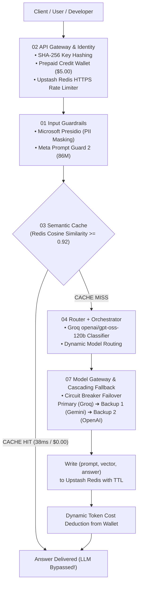

# ⚡ Nexus AI Gateway & Inference Platform

> **Enterprise AI Gateway, Smart Router & Observability Platform featuring 3 dedicated tiers:**
> - `backend/`: Python FastAPI Gateway, Upstash Redis REST, Presidio PII Masking, Prompt Guard, Semantic Cache, and Multi-Provider Fallback.
> - `user_frontend/`: Dedicated Developer Workspace (React, Vite, Tailwind CSS) for API keys, usage, and prompt testing.
> - `admin_frontend/`: Dedicated Operations Console (React, Vite, Tailwind CSS) for cluster health, circuit breakers, HITL approval queue, and audit logs.

---

## 📁 Repository Structure

```
nexus-ai-gateway/
├── backend/                  # 🚀 FastAPI Inference Engine & Gateway
│   ├── gateway/              # Identity, SHA-256 Auth, Upstash Redis Rate Limiter, Session Store
│   ├── guardrails/           # Presidio PII Masking & Meta Prompt Guard
│   ├── cache/                # Redis Cosine Similarity Semantic Cache (Gemini Embeddings)
│   ├── orchestrator/         # Intent Router, Model Gateway, Circuit Breakers, HITL Queue, RAG
│   ├── observability/        # Distributed Tracing, P95/P99 latency, Token metrics
│   ├── ops/                  # Non-blocking SQLite automated backups & 1-click restore
│   ├── eval/                 # Feedback telemetry & 7-layer Golden Set test suite
│   ├── tests/                # Concurrency stress & load testing harnesses
│   ├── main.py               # Application entry point & OpenAPI REST routes
│   └── requirements.txt      # Python dependencies
│
├── user_frontend/            # 👤 Developer Workspace (React + JavaScript)
│   ├── src/components/user/  # User Dashboard, Key Manager, Request History, Test Playground
│   ├── src/App.jsx           # Clean, distraction-free user application shell
│   └── vite.config.js        # Configured for Port 3000
│
└── admin_frontend/           # 👨‍💻 Operations & Admin Console (React + JavaScript)
    ├── src/components/admin/ # Executive Ops, User Directory, HITL Review Queue, Audit Logs
    ├── src/App.jsx           # Authoritative sentinel & observability operations shell
    └── vite.config.js        # Configured for Port 3001
```

---

## 🏛️ Architecture Pipeline



---

## 🚀 Quickstart Guide

### 1. Backend Service (`backend/`)
```bash
cd backend

# Create & activate Python virtual environment
python -m venv .venv
# Windows:
.venv\Scripts\activate
# Mac/Linux:
# source .venv/bin/activate

# Install dependencies
pip install -r requirements.txt

# Run the API Gateway
uvicorn main:app --reload --port 8000
```
- API Base URL: `http://localhost:8000`
- Interactive OpenAPI Docs: `http://localhost:8000/docs`
- Gateway Health Endpoint: `http://localhost:8000/health`

---

### 2. User Portal (`user_frontend/`)
```bash
cd user_frontend

# Install dependencies (if not already installed)
npm install

# Start User Workspace
npm run dev
```
- Accessible at: **`http://localhost:3000`**
- Features: API Key generation, token wallet balance, interactive prompt playground, request history inspector, and PII masking toggles.

---

### 3. Admin Operations Console (`admin_frontend/`)
```bash
cd admin_frontend

# Install dependencies (if not already installed)
npm install

# Start Admin Console
npm run dev
```
- Accessible at: **`http://localhost:3001`**
- Features: Circuit breaker health monitors (`Groq`, `Gemini`, `OpenAI`), User management directory, P95/P99 latency observability, Human-in-the-Loop (HITL) approval queue, and security audit log console.
